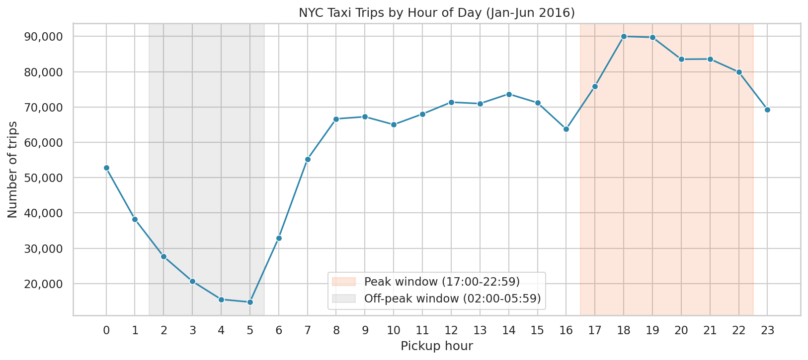
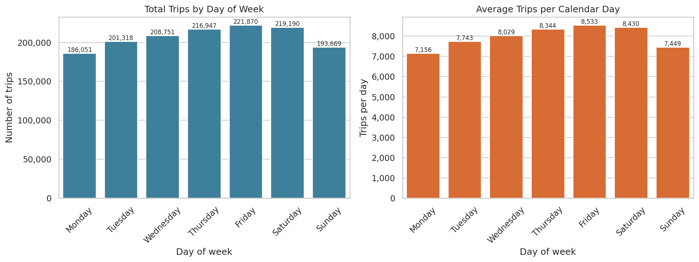
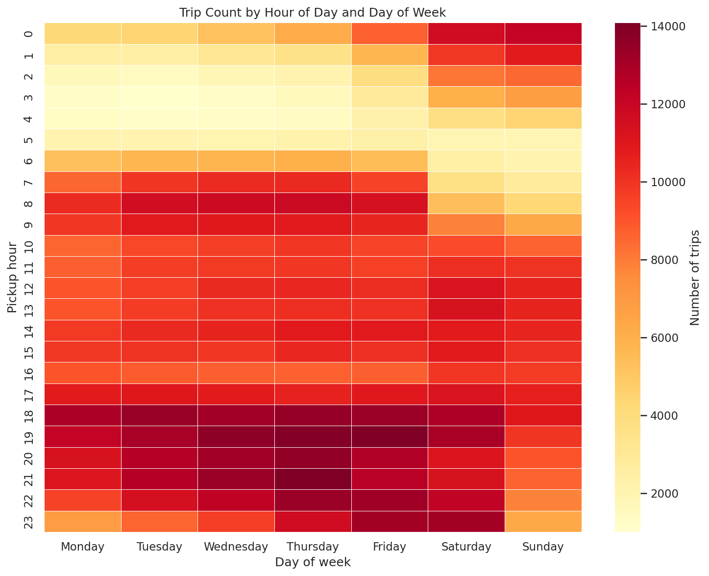
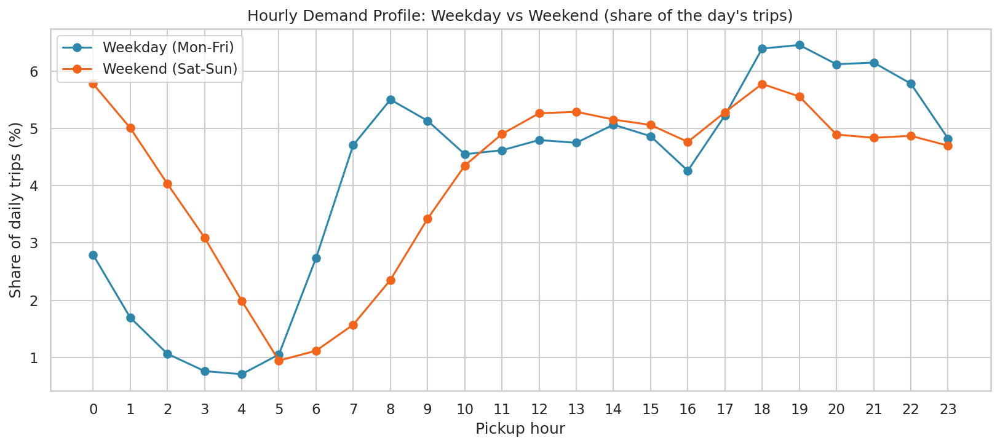
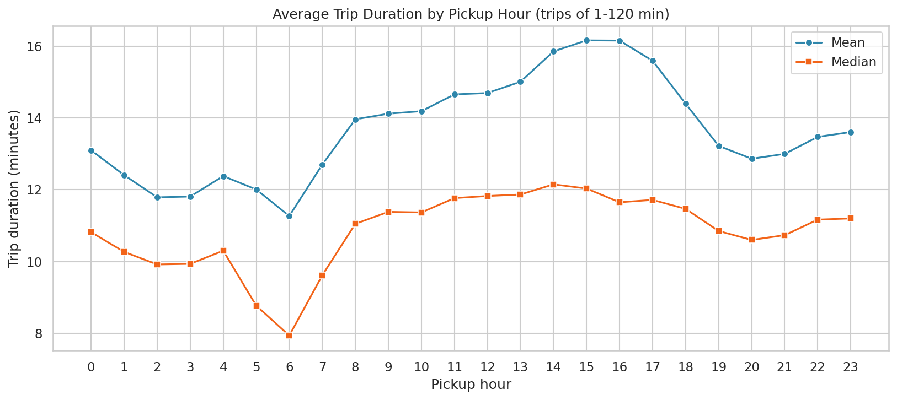
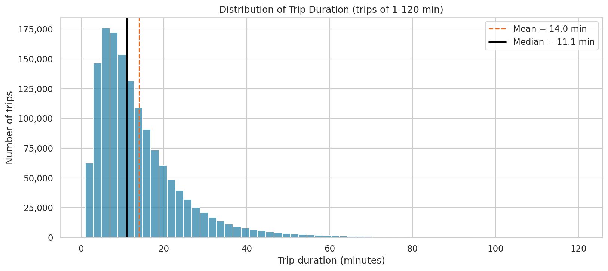
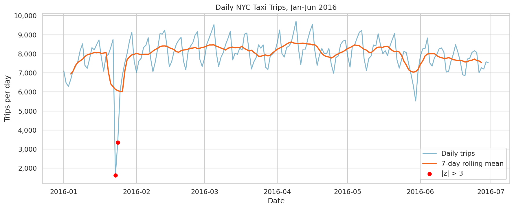
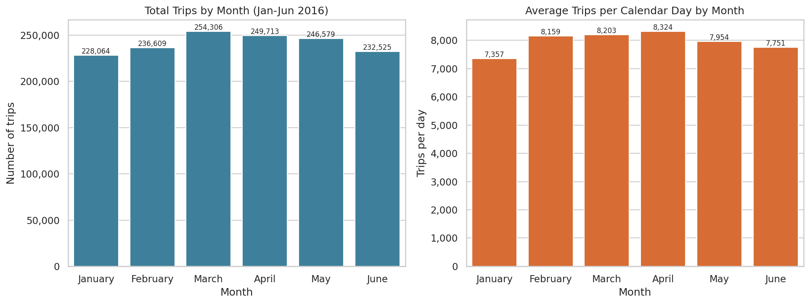
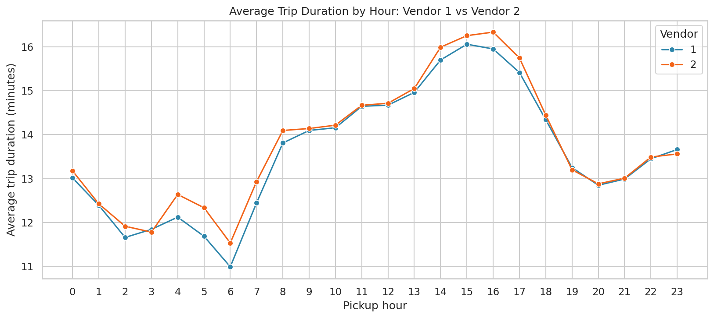

# Hourly and Daily Demand Patterns in NYC Taxi Trips

When do New York taxi trips peak, which days are busy, and how long do trips last? This project analyses **1,458,644 taxi trips (January–June 2016)** with time-based aggregations and turns the patterns into **four operational insights for fleet management**.

**Stack:** Python · pandas · NumPy · matplotlib · seaborn · SciPy

| Document | What it contains |
|---|---|
| [`notebook/nyc_analysis.ipynb`](notebook/nyc_analysis.ipynb) | Full analysis: cleaning, 9 charts, 8 statistical tests, final summary |
| [`notebook/README.md`](notebook/README.md) | Notebook structure, libraries and why each one was used |
| [`charts/README.md`](charts/README.md) | Each of the 9 charts with a link and a detailed analysis |
| [`data/README.md`](data/README.md) | Dataset description: rows, columns, data quality notes |

---

## At a glance

| Metric | Value |
|---|---|
| Trips analysed (after cleaning) | 1,447,796 of 1,458,644 (10,848 removed = 0.74%) |
| Busiest hour | **18:00**, 90,022 trips (6.2% of all trips) |
| Quietest hour | **05:00**, 14,767 trips (6.1× lower than 18:00) |
| Peak window 17:00–22:59 | **34.7%** of all trips in 6 of 24 hours |
| Busiest / quietest day | **Friday** 8,533 trips/day / **Monday** 7,156 trips/day (+19.3%) |
| Typical trip | Median **11.1 min**, mean 14.0 min |
| Longest trips by start hour | **15:00–16:59** (16.2 min mean) |

---

## Insights

### Insight 1 — The evening, not the morning, is the rush hour



Demand sits on a plateau of about 64–74k trips per hour from 08:00 to 16:59, then surges to **90,022 trips at 18:00** and stays high until 22:59. The six peak hours (17:00–22:59) carry **34.7% of all trips**; the four hours from 02:00 to 05:59 carry only 5.4%.

→ Details: [chart 1](charts/README.md#1-trips-by-hour-of-day)

### Insight 2 — Demand follows the day of the week, not "weekday vs weekend"



Friday averages **8,533 trips per day** and Monday **7,156** (+19.3%). Weekend days are *not* quieter: they average 7,940 trips against 7,961 on a weekday. The low days are **Monday and Sunday**. This is the strongest pattern in the project: weekday explains about 52% of the rank variance in daily trips (Kruskal-Wallis ε² = 0.52), and it holds after removing the two storm days.

→ Details: [chart 2](charts/README.md#2-trips-by-day-of-week)

### Insight 3 — Each day has its own rhythm: weekday commutes, weekend nights



The hottest slot is **Friday 19:00 (14,087 trips)**; the coldest is Tuesday 03:00 (1,001). On weekends the activity moves past midnight: between 00:00 and 03:59 a weekend day has **1,450 trips vs 503 on a weekday (2.9×)**.



The share of trips between 07:00 and 09:59 is **15.3% on weekdays but 7.3% on weekends**; the share between 00:00 and 03:59 is **17.9% on weekends but 6.3% on weekdays**.

→ Details: [chart 6](charts/README.md#6-hour--weekday-heatmap), [chart 7](charts/README.md#7-weekday-vs-weekend-hourly-profile)

### Insight 4 — Trip length and trip count peak at different times



Trips are longest when they start at **15:00–16:59 (16.2 min)** and shortest at 06:00 (11.3 min), a 43% difference. The busiest pickup hours (18:00: 14.4 min, 19:00: 13.2 min) have shorter trips than the afternoon. Measured in **occupied car-hours** (trips × average duration), 14:00, 15:00, 17:00 and 19:00 are all within about 11% of the 18:00 peak, so the afternoon keeps cars almost as busy as the evening.



Durations are right-skewed (skew 2.21): half of the trips last under 11.1 minutes, 95% under 34.8 minutes, and the mean (14.0) sits well above the median (11.1).

→ Details: [chart 3](charts/README.md#3-average-trip-duration-by-hour), [chart 4](charts/README.md#4-trip-duration-distribution)

### Insight 5 — Severe weather and holidays break the pattern



Only two of 182 days are statistical anomalies (|z| > 3): **23 January (1,627 trips, −79.5% vs the average day)** and **24 January (3,352, −57.9%)**. Demand needed until 26 January to come back to within 14% of average. The dates coincide with the January 2016 blizzard (**weather is not in the data, so this link is an assumption**). A smaller dip on 30 May (−30.6%) coincides with a US public holiday; this is also untested.

→ Details: [chart 9](charts/README.md#9-daily-trips-and-anomalies)

### Insight 6 — The monthly pattern is a six-month trend, not proven seasonality



March has the most trips in total (254,306) only because it has 31 days; **per calendar day April leads (8,324)**. Average trip duration rises from 13.2 min (Jan–Feb) to 14.9 min (June). Month explains only 0.26% of rank variance in duration, and six months cannot show a seasonal cycle.

→ Details: [chart 5](charts/README.md#5-monthly-trips)

### Insight 7 — The two vendors behave alike once outliers are removed



Vendor 2 has 53.5% of trips, vendor 1 46.5%; mean durations are 14.08 vs 13.93 min (effect size −0.005, negligible). In the raw data the vendor gap was 3.5 minutes, but it came from **2,170 trips longer than 120 minutes recorded by vendor 2** (96.3% of all such trips), including 1,839 trips lasting 23–24 hours. This points to a recording issue rather than real trips (interpretation).

→ Details: [chart 8](charts/README.md#8-vendor-duration-by-hour)

---

## Recommendations for fleet management

| # | Recommendation | Evidence | Confidence |
|---|---|---|---|
| 1 | **Have maximum fleet strength on the road from 17:00 to 23:00**; avoid shift changes between 17:00 and 20:00 | 17:00–22:59 = 34.7% of trips; 18:00 and 19:00 alone = 12.4% | High (182 days, 1.4M trips). Unmet demand is not observed |
| 2 | **Plan staffing by day, not by weekday/weekend**: lighter rosters and maintenance on Monday and Sunday, more capacity Thursday–Saturday | Friday 8,533 vs Monday 7,156 trips/day; weekend ≈ weekday per day | High for the pattern (26 observations per weekday); causes not in the data |
| 3 | **Add late-night cover on Friday and Saturday nights** (00:00–03:59) | 1,450 vs 503 trips per day (2.9×) | High |
| 4 | **Size afternoon capacity on occupied car-hours, not trip counts**; keep cars on the road through 14:00–22:59 | Afternoon trips are longest (16.2 min); car-hours at 14:00–15:00 are about 89–90% of the 18:00 peak | Medium: derived from average durations; locations not analysed |
| 5 | **Prepare a weather playbook**: scale the fleet down for severe weather and plan for a 2–3 day recovery; exclude such days from baseline forecasts | 23–24 Jan: −79.5% and −57.9%; January average rises from 7,357 to 7,693 trips/day without them | Medium: cause is external to the data |
| 6 | **Flag implausible trips at source** (under 1 minute, over 120 minutes) and review vendor 2's 23–24 hour trips | 10,848 rows (0.74%) removed; vendor 2 = 96.3% of trips over 120 min | Medium: cause is an interpretation |

**Next analyses that would raise confidence:** pickup zones (where the evening peak and afternoon long trips occur), weather and holiday data, a full year of trips, and demand that taxis could not serve.

---

## Statistical summary

Duration is right-skewed, so rank-based tests are used. All eight tests survive a Bonferroni correction (α = 0.05 / 8 = 0.0063), but with 1.4 million trips almost any difference is significant, so **effect size decides what matters**:

| Question | Test | Effect size | Verdict |
|---|---|---|---|
| Daily trips differ by weekday? | Kruskal-Wallis (182 days) | ε² = 0.52 | **Large** |
| Monday vs Friday daily trips | Mann-Whitney | r = −0.93 | **Large** |
| Duration differs by hour? | Kruskal-Wallis | ε² = 0.011 | Small |
| Duration differs weekday vs weekend? | Mann-Whitney | r = 0.07 | Negligible |
| Duration differs by month? | Kruskal-Wallis | ε² = 0.003 | Negligible |
| Vendor share changes by hour? | Chi-square | Cramér's V = 0.02 | Negligible |
| Duration differs between vendors? | Mann-Whitney | r = −0.005 | Negligible |
| Hourly trips vs hourly duration | Spearman (n = 24) | ρ = 0.55 | Moderate; association, not causation |

---

## Data cleaning in short

| Step | Result |
|---|---|
| Missing values / duplicates | 0 / 0 |
| `trip_duration` vs `dropoff − pickup` | Consistent in all rows |
| Removed: under 1 minute | 8,595 trips (0.59%) |
| Removed: over 120 minutes | 2,253 trips (0.15%) |
| Effect on duration | Mean 15.99 → 14.01 min (−12.4%); median 11.03 → 11.08 min |

Full details: [`data/README.md`](data/README.md) and notebook section 1.

---

## Differences from the reference notes in the task

| Reference note | What the data shows |
|---|---|
| ~170 trips over 24 hours | **4** trips over 24 hours (2,253 over 120 min; 8,595 under 1 min) |
| Mean 11.4 min, median 9.8 min | Clean data: mean **14.0**, median **11.1** |
| April has the highest average duration ("rainy season") | **June** is highest (14.9 min); April is 14.2. Weather is not in the data |
| Vendors 52/48 | 53.5% vendor 2 / 46.5% vendor 1 |
| Peak 18:00–19:00, quietest 05:00; Monday fewest, Friday most | Confirmed |

---

## Limitations

- **Six months only (Jan–Jun 2016):** seasonality cannot be established; January contains a storm event.
- **Pickups only:** no unmet demand, cancellations or fares.
- **No weather, traffic or location analysis:** the causes behind duration differences and anomalies are assumptions.
- **Filtering rule:** the 1–120 minute window follows the task and is a convention, not a data-derived threshold.
- **Correlation is not causation:** no association here was tested with a controlled experiment.

---

## Repository structure

```text
nyc-taxi-demand-analysis/
├── README.md                    # this file: insights and recommendations
├── requirements.txt
├── .gitignore                   # excludes the 200 MB NYC.csv
├── notebook/
│   ├── nyc_analysis.ipynb       # full analysis (executed)
│   └── README.md                # libraries and structure
├── charts/
│   ├── 01_trips_by_hour.png … 09_daily_trips_anomalies.png
│   └── README.md                # per-chart analysis
└── data/
    └── README.md                # dataset description (CSV not stored in the repo)
```

## How to reproduce

```bash
pip install -r requirements.txt
# download NYC.csv from Kaggle (yasserh/nyc-taxi-trip-duration) and place it in notebook/
jupyter notebook notebook/nyc_analysis.ipynb
```

**Dataset:** [Kaggle: NYC Taxi Trip Duration](https://www.kaggle.com/datasets/yasserh/nyc-taxi-trip-duration)
